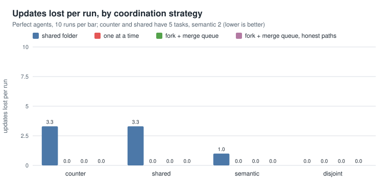

<h1 align="center">AgentTrunk</h1>

<p align="center"><b>Let several AI agents work on the same project at the same time, without overwriting each other.</b></p>

<p align="center">
  
  
  
  
  
  
</p>

<p align="center">
  <a href="#about">About</a> ·
  <a href="#user-guide">User guide</a> ·
  <a href="#developer-guide">Developer guide</a> ·
  <a href="docs/eval/results.md">Results</a> ·
  <a href="docs/design/README.md">Design docs</a>
</p>

---

# About

When you run two or more AI agents on one project (two Claude Code windows, Cursor plus a local model, a team of
agents started by a planner), they step on each other. One overwrites the other's file. Both read the same number,
both add one, and one of the additions disappears. A merge "succeeds" and leaves code that no longer runs.

**AgentTrunk is a shared workspace that stops this from happening.** Every agent gets its own private copy of the
project. When an agent says it is finished, its work goes through one checkpoint: the system merges it with what
other agents already finished, runs your checks, and only then adds it to the shared project (`main`). Work that
cannot be added safely is sent back to the agent, repaired, or handed to you with an explanation. Nothing an agent
does can corrupt the shared project, and a crashed agent can pick up where it stopped.

It plugs into the tools you already use through the [Model Context Protocol](https://modelcontextprotocol.io)
(MCP), or you can run a goal through its own command line. No paid service is required.

```
agent A ─┐                                       ┌─ your checks (tests, "did it do the job?") ─┐
agent B ─┼─►  own private copy ─► finished ─►  merge queue ─────────────────────────────────►  main
agent C ─┘                                       └─ conflict? stale? repair, retry, or ask you ─┘
                               │
              replicated store underneath (keeps working when a machine dies)
```

## Why you might want it

**1. Agents from different tools share one project without overwriting each other.**
Claude Code, Cursor, a local model: each one works on its own copy and submits when done. The system notices the
sneaky case, too. Say two agents both read `COUNT = 5` and each changes it to `6`. A plain merge sees two edits that
do not touch the same line and accepts both, and the project ends at `6` instead of `7`. AgentTrunk remembers what each
agent *looked at*, sees that the number changed after the agent read it, and sends that agent back to redo the step
on the new value. This is called a *stale read*, and ordinary merging does not catch it.

**2. "Done" means done, checked by a program instead of by asking the model again.**
Instead of trusting an agent that says "finished", you write what must be true when the task is complete, for example
"the test passes", "this file now contains the new route", "the version number went up by exactly one". The system checks
that itself when the work is submitted. These checks use no model tokens, so long tasks do not pay for repeated
"are you done yet?" prompts, and an agent that quietly did nothing is caught.

**3. Cheaper than starting over.**
When two agents collide, the expensive answer is "throw it away and redo the task". AgentTrunk first asks one short
question ("given the new state of this file, what would your change look like now?") and compares the answer by
program. In our measurements this cut the tokens spent on collisions by about a third to two thirds, depending on the
model (details in [the results](docs/eval/results.md)).

**4. Built to survive crashes, like a real distributed system.**
The workspace sits on a replicated key/value store that keeps running when a machine fails. An agent that is killed
midway resumes from its last checkpoint. A task whose owner died is taken over by someone else, and the dead owner can no
longer land stale work. A task that was already finished is never done twice.

**5. Bring any model.**
Local models through Ollama or any OpenAI-compatible endpoint, command-line agents such as `claude`, or whatever
MCP client you already use (it brings its own model). The project itself needs no paid API.

**6. You stay in control.**
A task board shows what is open, running, finished or waiting. You choose the rules per file: *append-only* files
(a changelog, a registry) where everyone's added lines are all kept, or strict files where any overlap needs a
decision. You choose the checks, the validation command, how many agents run in parallel, and how long a silent agent
keeps its task.

## Does it work? (short version)

| What we tested | Result |
|---|---|
| 32 agents, 160 tasks, about 1,600 line edits per run, 20 runs, with and without killed agents and killed storage replicas | **20/20 runs correct** with no edit lost and none applied twice, with and without faults. A shared folder and a git-style merge: 0/20 |
| Speed and cost of the same workload | 17.6x faster than one agent for 3.3% more tokens, with task times and costs replayed from recorded local-model runs |
| Cost of resolving collisions with the cheaper-than-redo step | about 33 to 65% fewer tokens on local models and on `claude -p` |

## Is this for you?

| You want to | Use |
|---|---|
| let agents in Claude Code, Cursor or any other MCP client share one project safely | the MCP server, `agenttrunk mcp` |
| hand a goal to several agents and get validated results | the `agenttrunk orchestrate` command |
| a git-like workspace for agents (fork, edit, merge, stale-read detection), embedded in your own program | the Python library `cmws_ws` |
| a linearizable, fault-tolerant key/value store with compare-and-set | the HTTP gateway |

**Not (yet) for you if** you need to coordinate binary files or large refactors across many files at once: merging and
checks are line-based text. The default setup runs on one machine, and there is no sign-in or multi-user separation.

---

# User guide

## Requirements

* Java 17 or newer and `make` (the store and gateway)
* Python 3.10 or newer, standard library only (the workspace, the agents and the command line)
* For agents that AgentTrunk runs itself: any OpenAI-compatible chat endpoint with tool calling (for example a local
  [Ollama](https://ollama.com)), or a command-line agent such as `claude`. MCP clients bring their own model.

## Quick start

Build and start the store with an HTTP gateway (2 shard groups of 3 replicas each, in one process):

```bash
make
make run-gateway ARGS="--port 8080 --groups 2 --replicas 3"
```

Make the `agenttrunk` command available (it is a small wrapper in this repository; or install it with
`pip install -e workspace`, which needs no other package):

```bash
export PATH="$PWD/bin:$PATH"
export AGENTTRUNK_URL=http://127.0.0.1:8080      # where the gateway is; this is also the default
```

Put a project in it and look at it:

```bash
agenttrunk init --from ./my-project
agenttrunk log
```

Add `--data-dir /some/dir` to the gateway arguments if you want a restarted store to keep its data.

## Use it from Claude Code, Cursor and other MCP clients

`agenttrunk mcp` is a [Model Context Protocol](https://modelcontextprotocol.io) server. Every client
session that connects is one agent: it takes a task from a shared board, gets its own private branch of the
project (normally as a folder it edits with its own tools), and submits; the merge is checked against your
validation command before `main` moves. Several sessions, on this machine or on several, share one project
without overwriting each other.

Put the tasks on a board (optional: agents can also add tasks of their own):

```bash
cat > tasks.json <<'JSON'
[{"id": "api",  "description": "Add a /health endpoint", "paths": ["server.py"]},
 {"id": "docs", "description": "Document the endpoint",  "paths": ["README.md"], "depends_on": ["api"]}]
JSON
agenttrunk board myboard --tasks tasks.json
```

Add the server to each client, one name per agent (keep the name the same across restarts and the agent
resumes its task). For Claude Code:

```bash
claude mcp add agenttrunk -- agenttrunk mcp --board myboard --agent alice \
    --validate-cmd "python3 -m unittest discover"
```

or in any client's MCP configuration:

```json
{"mcpServers": {"agenttrunk": {"command": "agenttrunk",
  "args": ["mcp", "--board", "myboard", "--agent", "alice", "--validate-cmd", "python3 -m unittest discover"]}}}
```

The agent then has these tools; every answer says what to do next:

| tool | what it does |
|---|---|
| `show_board` | which tasks are open, claimed, waiting for another task, done or failed |
| `claim_task` | take the next ready task (or a named one, or add one of your own with `description` and `paths`); you get a private branch and a folder |
| `task_status` | what you changed, whether `main` moved under you, files with conflict markers |
| `sync_with_main` | bring other agents' landed work into your branch; real conflicts become markers; it shows what `main` changed in files you also changed |
| `submit_task` | merge into `main` after the check: `landed`, or what to do (sync, resolve, fix the failed check) |
| `release_task` | give the task back |
| `list_escalations` | work the system left for a person |

Resources: `agenttrunk://board`, `agenttrunk://main` and `agenttrunk://main/{path}`. Options: `--workdir`
(where task folders go), `--claim-ttl` (how long a silent agent keeps its task), `--tasks`, `--main`, `--url`.
For a client without a file system add `--file-tools`: the branch is then edited through `list_files`,
`read_file`, `write_file`, `replace_in_file`, `delete_file` and `move_file`, each of which accepts a
`seq` number so that a retried call runs once. The same workflow without MCP is available to scripts as
`agenttrunk board`, `agenttrunk clone` / `push` / `submit` (see below).

A ready-made test project with ten tasks that collide on two shared files, a setup script that writes one MCP
configuration per agent, scripted agents to try it without a model (with an optional chaos mode that kills replicas
and an agent's server while it runs), and a checker is in [examples/mcp-demo](examples/mcp-demo). `agenttrunk export DIR` writes the files of `main` to a folder.

### For an orchestrating agent

A main agent that splits a goal and collects results can run its own `agenttrunk mcp` and use four more tools instead of reading diffs:
`add_tasks` (a list of tasks with paths, dependencies, merge policies and checks), `wait_for_tasks` (block until named tasks finish, up
to 10 minutes), `board_digest` (what landed, what failed in one line each, what needs a decision with the conflicting files) and
`explain_escalation` (the full record of one item).

## Give a goal to local or API models

Here a local Ollama model plans and does the work (the merged result must pass your test command before `main` moves):

```bash
agenttrunk orchestrate run1 \
    --goal "Add a div(a, b) function to mathx.py that raises ValueError on zero, with tests" \
    --model qwen2.5-coder:7b --parallel 3 --escalate \
    --validate-cmd "python3 -m unittest discover"
agenttrunk run-status run1
```

The model splits the goal into tasks, the tasks run in parallel on their own forks, and each finished
branch is merged into `main` only if the merged tree passes `--validate-cmd`. Run the same command again
with the same run id after a crash and it resumes instead of starting over. To use a command-line agent for every
task instead of a chat model, pass `--exec claude -p ...` (see [Running agents](#running-agents)).

## What happens to a branch that cannot land

1. automatic three-way merge (line-level merge for text, rename-aware for files);
2. a merger agent that sees both sides' intent and the conflict markers;
3. a redo of the task on top of what landed, with a summary of what changed;
4. a durable record for a person: `agenttrunk escalations`.

At every step the merged result must pass your validator, and a resolution that silently keeps only one
side, a branch that changed nothing although the agent said "done", and files an agent changed without
reading are all treated as failures to retry, not as success.

## Tell the system what your edits mean

Plain text cannot say whether two edits to a file are independent, so by default the system is careful: a file an
agent read and that someone else changed since is *stale* and the landing waits. Two optional declarations let you say
more, and each only ever relaxes or adds a check for the files you name.

**Merge policies.** A file `.agenttrunk-merge` at the project root (read from `main`, so an agent cannot relax its own
landing) lists a pattern and a policy per line; a task can also declare `"merge": {"registry.py": "append"}`.

```
registry.py   append       # lines added at the same place by several agents are all kept, in landing order
CHANGELOG.md  append
*.md          converge     # identical edits are agreement
```

| policy | meaning |
|---|---|
| `relative` (default) | an edit may depend on what the agent read: stale reads are refused |
| `converge` | identical edits are agreement; reads of this file are not validated |
| `append` | pure insertions at the same place commute; both sides' lines are kept. A modified or deleted line is still a conflict |

`append` is for files where order does not matter (a registry, a changelog). Do not use it for numbered migrations or
ids handed out in sequence. In the ten-task demo, declaring the two shared files `append` takes the number of syncs from
24 to 0 (`python3 examples/mcp-demo/simulate.py --append`).

**Acceptance checks.** A task can say what must be true *because it landed*, compared with `main` immediately before
the landing:

```json
{"id": "count", "description": "Increase COUNT by one", "paths": ["stats.py"],
 "accept": [{"kind": "increases", "path": "stats.py", "pattern": "COUNT = (\\d+)", "by": 1},
            {"kind": "contains", "path": "registry.py", "text": "REGISTRY['count']"}]}
```

Kinds: `contains`, `absent`, `increases`, `decreases`, `exists`, `missing`, `command` (runs without a shell, in a folder
holding the result; optionally also compares a number in its output between the old and the new tree). The checks are
validated strictly when the task is declared, they cost no model tokens, and a failure is reported to the agent as
`rejected` with the reason. `agenttrunk board` warns about a check that already passes on the current `main` (it could
not show that the task did its work).

Independently of any declaration, a landing is also refused when lines that either side *added or removed on purpose*
did not survive the merge (for example a merger agent that keeps one side).

## Work in a local folder

Any editor or tool can work on a branch through a plain folder:

```bash
agenttrunk clone alice ./alice-work
cd alice-work                   # edit files with anything
agenttrunk status               # also: pull, push -m "message", submit, resolve <path>, watch
```

`watch` keeps the folder and the branch in sync in the background. Conflicts appear as markers in the files
and block pushing until you resolve them; edits made while offline are merged when the store is reachable
again.

## Command reference

`agenttrunk [--url URL] [--main REF] COMMAND`, with the URL defaulting to `$AGENTTRUNK_URL`, then
`http://127.0.0.1:8080`. Without installing: `bin/agenttrunk`, or `PYTHONPATH=workspace/src python3 -m agenttrunk`.
(The old `CMWS_*` environment variables and `python3 -m cmws_ws.cli` still work; the Python package is
`cmws_ws`.)

| command | what it does |
|---|---|
| `init [--from DIR]` | create the repository, optionally from a folder |
| `log [--limit N]` | history of `main` |
| `clone AGENT DIR`, `status`, `pull`, `push`, `submit`, `resolve`, `watch` | work on a branch in a folder |
| `run-task AGENT "description" --model M \| --exec CMD…` | run one agent on a task in its own branch (`--submit` to land it) |
| `orchestrate RUN_ID --goal G \| --tasks FILE.json` | plan, run in parallel, validate and land; resumable |
| `run-status RUN_ID` | the plan, each task's state and the result of a run |
| `board NAME [--tasks FILE]` | create a board of tasks for agents to claim, or show it |
| `mcp [--board B --agent A ...]` | serve the workspace to MCP clients (see above) |
| `export DIR` | write the files of `main` to a folder |
| `escalations` | work the merge queue could not land and left for a person |

`orchestrate` options: `--model` and `--llm-url` (default `http://127.0.0.1:11434/v1`, or `$AGENTTRUNK_LLM_URL`),
`--exec CMD…` to use a command-line agent for every task, `--validate-cmd`, `--parallel`, `--escalate`
(let the model resolve conflicts and redo tasks), `--checkpoint-every`, `--claim-ttl`, `--owner`, `--reapply model|claude`
and `--layers` (the cheaper-than-redo step, see Part 3), and `--llm-host` for a reverse proxy in front of Ollama that needs
a `Host` header such as `localhost:11434`. `--tasks` takes a JSON list of `{"id", "description", "paths", "depends_on"}`.

Task ids are letters, digits, `_` and `-`; run ids are letters, digits and `_` (at most 32). Inside a run a
task is named `RUN-TASK`, so two runs can use the same task names.

## Troubleshooting

| you see | what it means |
|---|---|
| `stale` on submit | a file you read was changed by someone else after you read it; run `sync_with_main`, look at what changed, redo the dependent edit |
| `rejected` with a reason | your validation command or an acceptance check failed on the merged result |
| conflict markers in a file | two agents changed the same lines differently; resolve them (or let the merger agent), then submit again |
| a task shows as claimed by a silent agent | its claim expires after `--claim-ttl`; then another agent can take it |
| `agenttrunk escalations` lists items | the system tried every automatic step and left the decision to you; each item says why |

---

# Developer guide

## How it is built

```
workspace/src/cmws_ws        Python: versioned workspace, merge, checks, agents, merge queue, MCP server, CLI
        │ HTTP (compare-and-set)
modules/gateway              HTTP front end and in-process cluster
        │
modules/sharded-kv           sharded store with live reconfiguration
modules/paxos                multi-Paxos replicated state machine
modules/primary-backup       primary-backup replication with a view service
modules/rpc-kvstore          at-most-once layer and the key/value state machine
```

Protocol logic never performs I/O: a core returns effects (`Send`, `SetTimer`, `Persist`, …) and a thin node
adapter carries them out, which is what makes the replication code testable.

The workspace stores content-addressed files and commits in the store and moves branch references with compare-and-set,
so concurrent landings form one history. The design documents in [docs/design](docs/design/README.md) explain each layer:
exactly-once RPC, primary-backup, Paxos, the sharded store, the workspace engine, local sync, workers, scheduling and leases,
the merge queue, reliability and the orchestrator, the MCP server, update consistency and efficiency, and the scale and
cost target.

## Layout

```
modules/rpc-kvstore       at-most-once layer and the key/value state machine
modules/primary-backup    primary-backup replication with a view service
modules/paxos             multi-Paxos replicated state machine
modules/sharded-kv        sharded store with live reconfiguration
modules/gateway           HTTP front end and in-process cluster
workspace/src/cmws_ws     versioned workspace, merge, sync, leases, claims, agents, MCP server, CLI
bin/agenttrunk            the command, runnable from a checkout without installing
workspace/eval            evaluation harness, stress harness and recorded results
workspace/tests           tests, including runs against the real gateway with replicas killed
examples/mcp-demo         a ten-task MCP demo with scripted agents and a checker
docs/design               design documents
docs/eval                 evaluation report and figures
jars/                     third-party and test-harness binaries
```

## Build and test

```bash
make                              # compile everything
make test-workspace               # workspace, agents, MCP, evaluation and cluster integration tests
python3 run-tests.py -l 5         # the store's own tests (unit, integration, gateway, durability)
python3 run-tests.py -l 4 -p 2    # sharded store suite (also -l 1 .. -l 3)
```

Cross-group multi-key transactions are out of scope; the suite under `ShardStorePart2Test` is not expected
to pass.

## Using the workspace from Python

```python
from cmws_ws.kv import HttpKV                 # or MemoryKV() for an in-process store
from cmws_ws.repo import Repository

repo = Repository.init(HttpKV("http://127.0.0.1:8080"), {"app.py": b"print('hi')\n"})

alice, bob = repo.fork("alice"), repo.fork("bob")     # private snapshots of main
alice.write("app.py", "print('hello')\n")
alice.commit("friendlier greeting")
bob.write("README.md", "# demo\n")
bob.commit("add readme")

print(repo.submit(alice).status)    # fast-forward
print(repo.submit(bob).status)      # merged  (bob's work is merged onto alice's)
```

`submit` merges the branch with whatever landed in the meantime and moves `main` with a compare-and-set, so
concurrent submissions form one history. It reports instead of guessing when it cannot land:

| status | meaning |
|---|---|
| `fast-forward`, `merged` | landed |
| `noop` | nothing to land, or it is already in `main` |
| `conflict` | the same lines were changed differently; the result lists the conflicting paths |
| `stale` | a file the agent read has changed since, even if the agent's edits do not overlap |
| `rejected` | your `validate` function refused the merged result |

Stale-read detection matters for agents that read a value and write one derived from it (a counter, a
version number): a plain textual merge would silently lose one of two concurrent increments.

Isolation levels, from weakest to strongest: a shared folder; `gitlike` (text merge and validation, no read set);
`snapshot` (stale reads are refused); `serializable` (also checks that lines added or removed on purpose survive, and
the task's acceptance checks). The checker in `cmws_ws/serial.py` replays landed tasks in landing order and compares
the result with `main`.

## Running agents

An agent is anything that implements `run(task, repo, agent_id)`; two are included.

* **`LoopWorker`**: a tool-calling loop over any OpenAI-compatible endpoint, with file tools (list, read,
  write, replace, delete, move) and a `finish` call. With `checkpoint_every=n` it commits and records its
  conversation every `n` tool calls and resumes from the last record after a crash.
* **`CliWorker`**: checks the branch out into a folder, runs a command-line agent there and pushes the
  result, e.g. `CliWorker(["claude", "-p", "{prompt}", "--permission-mode", "acceptEdits"])`. It reads token use from
  `claude -p --output-format json`.

```python
from cmws_ws.agents import (LoopWorker, MergeQueue, CommandValidator, OpenAICompatModel,
                            Orchestrator, Task, TaskGraph, merger_worker)

model = OpenAICompatModel("qwen2.5-coder:7b", "http://127.0.0.1:11434/v1")
worker = LoopWorker(model, checkpoint_every=3)
queue = MergeQueue(repo,
                   validator=CommandValidator(["python3", "-m", "unittest", "discover"]),
                   merger=merger_worker(model),        # tries to resolve conflicts
                   redo_worker=worker,                 # then redoes the task on the new main
                   max_redos=3)                        # then a person (see `cli escalations`)
tasks = TaskGraph([Task("api", "Add a /health endpoint", ("server.py",)),
                   Task("docs", "Document the endpoint", ("README.md",), depends_on=("api",))])
summary = Orchestrator(repo, worker, queue=queue, parallel=4).run("run1", graph=tasks)
print(summary.landed, summary.failed, summary.skipped)
```

A task lists the files it expects to touch. Tasks with disjoint files run at the same time; tasks that
overlap run one after another, each starting from a `main` that already contains the earlier work. If a
task touches more than it declared, it is noted, and the merge machinery still protects `main`.

### Cheaper than a redo (optional)

When a branch is stale because main changed a file the agent also changed, redoing the whole task is the expensive way
out. With `MergeQueue(reapply=ModelReapplier(model))` (or `agenttrunk orchestrate --reapply model|claude`) the queue first
asks, for each such file, what it would look like if the agent carried out its task again on the current main, and a
program compares the answer with main: equal means the change is already there, different means the answer is the
resolution. It still goes through every check before landing. A second layer, `continue_worker=worker`, hands the
agent's own conversation one message instead of starting over. Both are off by default; a task can choose its layers
(`"layers": [2, 4]`). Declaring `accept` checks is what keeps a model's wrong "it is already done" from losing work.

### Many agents at once

Validation is the serial part: the plain queue validates one landing at a time, so with many agents it caps the speedup however
many there are (3.6x in the simulation). `BatchQueue(repo, validator, window=0.05, max_batch=8)` lands the branches that finish
together with one validation and one move of `main`; a branch that cannot join (stale, conflicting, refused by a check) leaves
the batch and takes the ordinary chain, and a refused batch is split until the bad branch is alone. `main` still only holds states
the validator approved as they stand. In the simulation it reached 15x with 32 agents; with a single agent it only adds the wait.

`Orchestrator(hedge_after=3.0)` starts one backup agent when a task has run three times as long as the median of the others; the
first to land wins and the other is discarded, which cut a straggler-dominated run from 3.5 s to 1.6 s for 6% more agent runs.
`Orchestrator(share_context=True)` hands every agent a map of the project computed once (not measured to save tokens). Both are
off by default.

### Surviving crashes

* Tool calls carry sequence numbers and run once; a retried call returns the recorded answer.
* Tasks are claimed with an expiring claim; if an orchestrator dies, another one (or the same one,
  restarted) takes its tasks over once the claim runs out, and the replaced owner can no longer land. Before taking a task over,
  the new owner looks for a commit of that task on `main`, so work that landed just before the crash is not done again.
* Re-running `orchestrate` with the same run id skips finished tasks and continues the rest.
  `--claim-ttl` sets how long a dead orchestrator's tasks stay claimed (default 300 s).

## The key/value store

The gateway exposes the store over HTTP, including compare-and-set and fault injection:

```bash
curl -X PUT  --data 'hello'  localhost:8080/kv/greeting          # write
curl                         localhost:8080/kv/greeting          # read (404 if missing)
curl -X POST --data 'v1'     localhost:8080/kv/head/cas          # create: the key must not exist
curl -X POST --data 'v2'     'localhost:8080/kv/head/cas?expected=v1'   # advance if it still holds v1
curl -X POST --data 'alice'  localhost:8080/kv/owner/put-if-absent
curl -X POST 'localhost:8080/admin/kill?node=server1-2'          # cut a replica off
curl -X POST 'localhost:8080/admin/revive?node=server1-2'
```

The conditional operations answer `{"success":true|false,"value":...}` where `value` is what the key holds
afterwards. Add `--data-dir /some/dir` to the gateway arguments and a restarted cluster keeps its data.
A majority of replicas in each group must be reachable for operations to complete.

## Evaluation

`workspace/eval/` compares coordination strategies on tasks that collide on purpose (a lost update, adjacent
edits, a rename that text-merges into a broken program) with perfect agents, a local model and a mix of a
local model and a command-line agent, and injects faults into the real store. The results and what they
mean are in [docs/eval/results.md](docs/eval/results.md). In short: agents sharing one folder lose updates
and can leave a broken program; fork + validating merge queue lost none and left `main` valid in every
run once the checks described above were in place, at a few percent overhead.



```bash
python3 workspace/eval/run_eval.py --backends oracle --reps 5 --out out.jsonl && python3 workspace/eval/report.py out.jsonl
```

To see how often the cases that matter occur in real code, point the replay at any git repository with merge commits (it reads the
history only; no model, no cost):

```bash
python3 workspace/eval/replay.py --repo /path/to/repo --limit 1000 --table
```

### Stress test at 32 agents

`python -m stress cluster --runs 20 [--faults]` (run from `workspace/eval`) starts the replicated store, runs 160 generated tasks (1,600
line edits) with 32 scripted agents in 4 processes, optionally kills replicas and an agent process meanwhile, and decides correctness by
program: serial replay of the landed tasks, every edit exactly once, every state of `main` valid, every claim completed. 20 of 20 runs
were correct without faults and 20 of 20 with them, where a shared folder and a git-style merge were correct in 0 of 20. With task
costs replayed from recorded `eco` runs the same workload ran 17.6x faster than one agent for 3.3% more tokens (agents assumed to scale;
see `docs/eval/results.md` for what that does and does not show).

## Origin

See [NOTICE](NOTICE).
