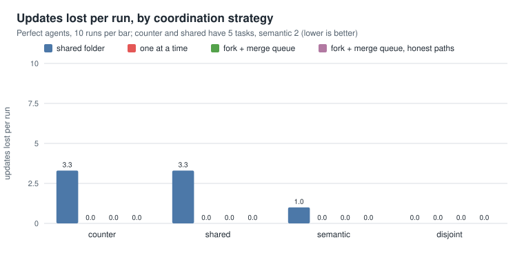
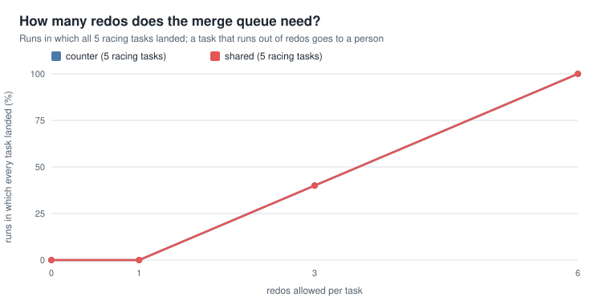
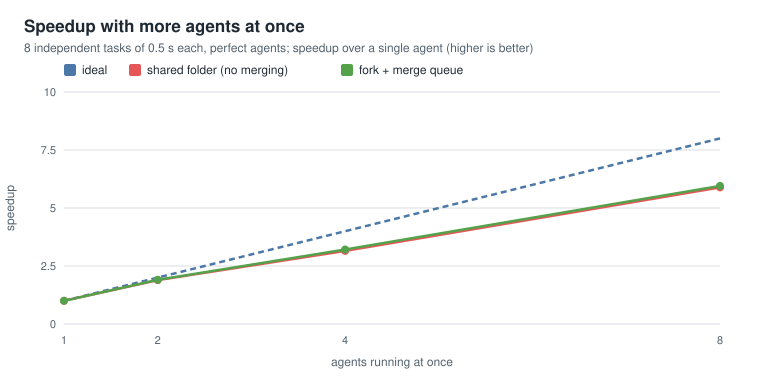
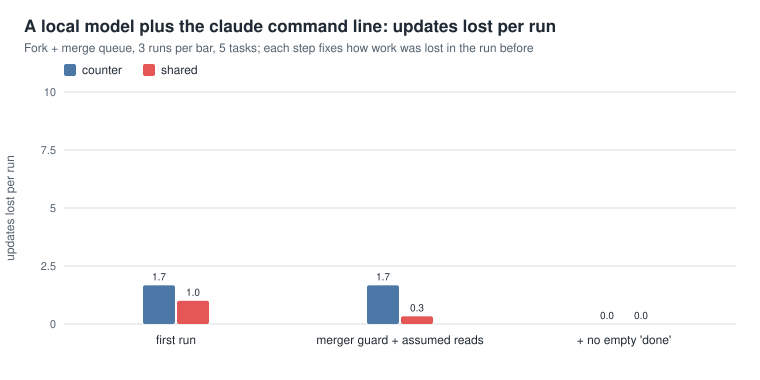

# Evaluation: does fork + merge queue beat the alternatives?

Everything here is reproducible from `workspace/eval/` (see the end). Raw rows are in
`workspace/eval/results/*.jsonl`.

## Questions

1. When several agents work at once on one project, what does each coordination strategy lose?
2. What does the safe strategy cost in time and tokens?
3. Does it hold up when agents and storage replicas are killed?

## Method

**Suites (E1).** Small projects with tasks that are meant to run at the same time. Each task declares
the files it expects to touch; for the collision suites the declaration is narrower than what the task
really touches, as a planner that missed the overlap would make it.

| suite | tasks | what collides |
|---|---|---|
| `disjoint` | 4 | nothing (control) |
| `counter` | 5 | every task changes the number on the same line (`COUNT = n` becomes `n + 1`): a lost-update test |
| `shared` | 5 | every task appends a function and a registry line to the same file: adjacent edits |
| `semantic` | 2 | one task renames a function, the other adds a new caller of the old name: the text merges cleanly, the program breaks |

Each suite has an *invariant* (the project still imports and runs; this is also what the merge queue
validates) and a *probe* that reports which tasks' effects are present in a final tree.

**Strategies (E2).**

* `serial`: one agent at a time, each starting from what the previous one landed. Safe baseline.
* `naive`: all agents at once in one shared folder, no isolation, last writer of a file wins.
* `forkmerge`: all at once, each on its own fork, landed through the validating merge queue
  (auto-merge, then merger agent, then redo up to a budget, then a person).
* `forkmerge-honest`: the same, but the tasks declare their real files, so the scheduler serializes
  overlapping ones instead of letting them collide.

**Agents.** `oracle`: perfect agents that read, wait 0.15–0.45 s, then write what they computed from what
they read. They isolate what the *strategy* does from what a *model* does: if even perfect agents lose
updates, the strategy lost them. `ollama`: the real tool loop over `eco` (9B) through Tailscale.

**Metrics (E3).** *all correct* (every task's effect present and the invariant holds), *tasks satisfied*,
*lost updates* (an agent reported done, its effect is not in the final tree), *main broken* (the invariant
fails on the final state), *conflicts* (first landing attempt was not clean), *human escalations*, wall
seconds, tokens (the model's own count; the command-line agent does not report one).

## Results with perfect agents (10 runs per cell)



| suite | strategy | runs | all correct | tasks satisfied | lost updates | main broken | conflicts | human escalations | seconds |
|---|---|---|---|---|---|---|---|---|---|
| counter | forkmerge | 10 | 5/10 | 45/50 | 0.0 | 0/10 | 3.7 | 0.5 | 1.42 |
| counter | forkmerge-honest | 10 | 10/10 | 50/50 | 0.0 | 0/10 | 0.0 | 0.0 | 1.65 |
| counter | naive | 10 | 0/10 | 17/50 | 3.3 | 0/10 | 0.0 | 0.0 | 0.51 |
| counter | serial | 10 | 10/10 | 50/50 | 0.0 | 0/10 | 0.0 | 0.0 | 1.60 |
| disjoint | forkmerge | 10 | 10/10 | 40/40 | 0.0 | 0/10 | 0.0 | 0.0 | 0.41 |
| disjoint | forkmerge-honest | 10 | 10/10 | 40/40 | 0.0 | 0/10 | 0.0 | 0.0 | 0.41 |
| disjoint | naive | 10 | 10/10 | 40/40 | 0.0 | 0/10 | 0.0 | 0.0 | 0.39 |
| disjoint | serial | 10 | 10/10 | 40/40 | 0.0 | 0/10 | 0.0 | 0.0 | 1.31 |
| semantic | forkmerge | 10 | 0/10 | 10/20 | 0.0 | 0/10 | 1.0 | 1.0 | 1.35 |
| semantic | forkmerge-honest | 10 | 0/10 | 10/20 | 0.0 | 0/10 | 1.0 | 1.0 | 1.67 |
| semantic | naive | 10 | 0/10 | 10/20 | 1.0 | 10/10 | 0.0 | 0.0 | 0.35 |
| semantic | serial | 10 | 0/10 | 10/20 | 0.0 | 0/10 | 1.0 | 1.0 | 1.67 |
| shared | forkmerge | 10 | 5/10 | 45/50 | 0.0 | 0/10 | 3.5 | 0.5 | 1.43 |
| shared | forkmerge-honest | 10 | 10/10 | 50/50 | 0.0 | 0/10 | 0.0 | 0.0 | 1.65 |
| shared | naive | 10 | 0/10 | 17/50 | 3.3 | 0/10 | 0.0 | 0.0 | 0.51 |
| shared | serial | 10 | 10/10 | 50/50 | 0.0 | 0/10 | 0.0 | 0.0 | 1.65 |

* `naive` loses updates exactly where tasks overlap: on `counter` an average of 3.3 of the 5 increments
  disappear, and on `semantic` all 10 runs end with a program that no longer works.
* `forkmerge` never loses an update and never leaves main broken: 0 lost updates and 0 broken mains in
  all 30 collision runs, *for agents whose reads are recorded* (see the mixed run below for what happens
  when they are not). The cost shows in "all correct": with a redo budget of 3 only half the runs
  finish every task (the rest are handed to a person, not lost).
* On `semantic` no strategy can fully succeed with perfect-but-fixed agents: the second task's edit
  still calls the old name. `forkmerge` and `serial` refuse to land it; `naive` lands it and breaks the
  program. Models can adapt where the oracle cannot (see below).
* `forkmerge-honest` and `serial` are always correct. Declaring real scopes makes the scheduler serialize
  the colliding tasks, so no conflicts occur and nothing needs redoing.

### How many redos does the queue need?



When tasks race for the same line, each redo can lose the race again to a task that landed in the meantime.

| tag | suite | runs | all correct | tasks satisfied | lost updates | conflicts | human escalations | seconds |
|---|---|---|---|---|---|---|---|---|
| redos=0 | counter | 10 | 0/10 | 20/50 | 0.0 | 3.0 | 3.0 | 0.56 |
| redos=0 | shared | 10 | 0/10 | 20/50 | 0.0 | 3.0 | 3.0 | 0.57 |
| redos=1 | counter | 10 | 0/10 | 28/50 | 0.0 | 3.7 | 2.2 | 0.87 |
| redos=1 | shared | 10 | 0/10 | 27/50 | 0.0 | 3.5 | 2.3 | 0.87 |
| redos=3 | counter | 10 | 4/10 | 44/50 | 0.0 | 3.7 | 0.6 | 1.39 |
| redos=3 | shared | 10 | 4/10 | 44/50 | 0.0 | 3.6 | 0.6 | 1.39 |
| redos=6 | counter | 10 | 10/10 | 50/50 | 0.0 | 3.6 | 0.0 | 1.57 |
| redos=6 | shared | 10 | 10/10 | 50/50 | 0.0 | 3.6 | 0.0 | 1.57 |

The needed budget grows with contention: with 5 racing tasks, 6 redos always sufficed, 3 did in 40% of the
runs, and 0 or 1 left most tasks for a person. The failure is always an escalation, never a lost update.

### Speed (8 independent tasks of 0.5 s)



| parallel | naive (s) | fork+merge (s) | speedup of fork+merge vs parallel=1 | overhead vs naive |
|---|---|---|---|---|
| 1 | 4.08 | 4.33 | 1.0x | 6% |
| 2 | 2.16 | 2.27 | 1.9x | 5% |
| 4 | 1.30 | 1.35 | 3.2x | 4% |
| 8 | 0.69 | 0.73 | 6.0x | 5% |

Fork + merge scales like the unprotected baseline (6.0x with 8 at once) and costs about 5% more than
writing into a shared folder, which is the price of branches, merging and validation.

## Results with a real model (`eco`, 9B, 3 runs per cell)

| tag | suite | strategy | runs | all correct | tasks satisfied | lost updates | main broken | conflicts | human escalations | seconds | tokens |
|---|---|---|---|---|---|---|---|---|---|---|---|
| eco | counter | forkmerge | 3 | 0/3 | 10/15 | 0.0 | 0/3 | 3.3 | 1.7 | 22.30 | 18608 |
| eco | counter | forkmerge-honest | 3 | 3/3 | 15/15 | 0.0 | 0/3 | 0.0 | 0.0 | 8.71 | 15896 |
| eco | counter | naive | 3 | 1/3 | 9/15 | 1.7 | 0/3 | 0.0 | 0.0 | 13.33 | 30085 |
| eco | counter | serial | 3 | 3/3 | 15/15 | 0.0 | 0/3 | 0.0 | 0.0 | 8.92 | 16657 |
| eco | disjoint | forkmerge | 3 | 3/3 | 12/12 | 0.0 | 0/3 | 0.0 | 0.0 | 6.18 | 12594 |
| eco | disjoint | forkmerge-honest | 3 | 3/3 | 12/12 | 0.0 | 0/3 | 0.0 | 0.0 | 6.14 | 12599 |
| eco | disjoint | naive | 3 | 3/3 | 12/12 | 0.0 | 0/3 | 0.0 | 0.0 | 6.15 | 12587 |
| eco | disjoint | serial | 3 | 3/3 | 12/12 | 0.0 | 0/3 | 0.0 | 0.0 | 7.17 | 12607 |
| eco | semantic | forkmerge | 3 | 2/3 | 5/6 | 0.0 | 0/3 | 1.0 | 0.3 | 13.40 | 10972 |
| eco | semantic | forkmerge-honest | 3 | 3/3 | 6/6 | 0.0 | 0/3 | 0.0 | 0.0 | 6.41 | 11153 |
| eco | semantic | naive | 3 | 1/3 | 4/6 | 0.7 | 2/3 | 0.0 | 0.0 | 5.50 | 10576 |
| eco | semantic | serial | 3 | 3/3 | 6/6 | 0.0 | 0/3 | 0.0 | 0.0 | 6.10 | 10568 |
| eco | shared | forkmerge | 3 | 0/3 | 12/15 | 0.0 | 0/3 | 4.0 | 1.0 | 34.05 | 28406 |
| eco | shared | forkmerge-honest | 3 | 3/3 | 15/15 | 0.0 | 0/3 | 0.0 | 0.0 | 12.72 | 17721 |
| eco | shared | naive | 3 | 2/3 | 14/15 | 0.0 | 0/3 | 0.0 | 0.0 | 19.67 | 39492 |
| eco | shared | serial | 3 | 3/3 | 15/15 | 0.0 | 0/3 | 0.0 | 0.0 | 16.79 | 23570 |
| eco-redo5 | counter | forkmerge | 3 | 3/3 | 15/15 | 0.0 | 0/3 | 3.3 | 0.0 | 29.50 | 19284 |
| eco-redo5 | shared | forkmerge | 3 | 3/3 | 15/15 | 0.0 | 0/3 | 4.0 | 0.0 | 36.15 | 28212 |

What the table shows, and what it cannot:

* The same pattern appears with a real model. `naive` lost updates on `counter` (1.7 per run) and ended with a
  broken program in 2 of 3 `semantic` runs. `forkmerge` lost no update and left main valid in all 18 runs.
* On `semantic` the real model, unlike the oracle, often adapted: after the merge was refused it redid the
  second task on top of the rename (2/3 runs fully correct).
* With the default redo budget of 2, `forkmerge` on `counter` and `shared` handed 1–2 tasks to a person per
  run; with a budget of 5 (`eco-redo5`) all six runs were fully correct.
* **Confound.** The Ollama server does not serve requests concurrently, so the agents' model calls were
  queued. This keeps interleaving real (edits, commits and landings of different agents do overlap) but
  makes `naive` collide less than it would with truly parallel models, and makes the seconds meaningless
  as speedups. The scaling claim rests on the oracle runs only.
* Three runs per cell, one 9B model, small projects: this shows the mechanism works end to end, not how
  often a given model succeeds.

## Mixed agents: a run that found three gaps



Tasks alternate between the local model and the `claude` command line (`mixed`: the odd ones are done by
`claude -p` in a folder), so that different kinds of agents collide. 3 runs per cell, redo budget 5.

| suite | strategy | runs | all correct | tasks satisfied | lost updates | main broken | conflicts | human escalations | seconds |
|---|---|---|---|---|---|---|---|---|---|
| counter | forkmerge | 3 | 0/3 | 10/15 | 1.7 | 0/3 | 3.0 | 0.0 | 51.84 |
| counter | naive | 3 | 0/3 | 10/15 | 1.7 | 0/3 | 0.0 | 0.0 | 15.80 |
| shared | forkmerge | 3 | 0/3 | 12/15 | 1.0 | 0/3 | 3.0 | 0.0 | 25.04 |
| shared | naive | 3 | 1/3 | 11/15 | 1.0 | 0/3 | 0.0 | 0.0 | 14.21 |

This contradicts the claim above: `forkmerge` lost 1–2 of 5 updates per run, about as many as `naive`. The
harness records, for each run, how every task was landed (`via`), and every lossy run included landings
by the merger agent. Digging into it showed three separate gaps, found one after another (each rerun of the mixed experiment
exposed the next one):

1. **A merger that keeps one side.** Resolving the marked conflict `COUNT = 1` against `COUNT = 2`, the
   small merger model kept one of them. The result imports and runs, so validation (the project
   invariant) cannot see that a task's effect is gone. *Fix:* the queue now refuses a merger resolution
   that equals one side's whole file in a conflicted path (`keep_both_sides`, on by default), and the task
   is redone on top of what landed instead. Tested with scripted mergers that keep either side, one that
   combines both, and with the guard off to show the loss (`tests/test_mergequeue.py`).
2. **Identical edits merge as agreement.** A folder-based agent never says what it read. Two of them that
   each turned `COUNT = 0` into `COUNT = 1` from the same base look like two people making the same change,
   and the merge takes it once: one increment is lost *without any conflict*. The stale-read check, which
   exists for exactly this, had nothing to work with. *Fix:* `CliWorker` now records every file the
   command changed as a read at the fork base (`assume_reads`, on by default), since a changed file was
   necessarily read; the second landing is then refused as stale and redone. This is conservative: two
   edits to different parts of the same file are also redone rather than merged.

3. **"Done" without a change.** After the first two fixes the merger no longer landed anything, yet `counter` still
   lost 1–2 updates per run, all in automatic and redo landings. The queue had counted a branch with no
   edits as landed (`noop`). When a task is redone, the model is told that other changes have landed
   meanwhile; some agents (here the odd-numbered, `claude`-run tasks) concluded the task was already
   done and changed nothing, so the increment was never made, with no conflict and no failed validation.
   *Fix:* a worker result of "done" with no commit is not a landing (`require_changes`, on by default): the
   task is redone and told that its last attempt changed nothing, and a redo that again changes nothing is
   not accepted either. The per-task records of the next run confirm it: the guard fired 1–4 times per run,
   always on the same two tasks, both automatically and in redos (`mixed_eco_claude_after_fixes2.jsonl`).

Perfect agents with unrecorded reads reproduce gap 2 exactly, and the fix removes it (10 runs per cell,
5 racing tasks, redo budget 6):

| tag | suite | runs | all correct | tasks satisfied | lost updates |
|---|---|---|---|---|---|
| A untracked, no guard | counter | 10 | 0/10 | 22/50 | 2.8 |
| A untracked, no guard | shared | 10 | 10/10 | 50/50 | 0.0 |
| B untracked, guard | counter | 10 | 0/10 | 22/50 | 2.8 |
| B untracked, guard | shared | 10 | 10/10 | 50/50 | 0.0 |
| C untracked + assumed reads, guard | counter | 10 | 10/10 | 50/50 | 0.0 |
| C untracked + assumed reads, guard | shared | 10 | 10/10 | 50/50 | 0.0 |

(Rows A and B are identical because here the loss happens in the automatic merge, so the merger guard of
gap 1 is not involved; gap 1 is covered by the unit tests.)

**After all three fixes**, the same mixed experiment (3 runs per cell, redo budget 5, fork + merge queue):

| suite | strategy | runs | all correct | tasks satisfied | lost updates | main broken | conflicts | human escalations | seconds |
|---|---|---|---|---|---|---|---|---|---|
| counter | forkmerge | 3 | 3/3 | 15/15 | 0.0 | 0/3 | 2.7 | 0.0 | 43.67 |
| shared | forkmerge | 3 | 3/3 | 15/15 | 0.0 | 0/3 | 3.3 | 0.0 | 51.27 |

All 6 runs end fully correct with no lost update. Resolution took 2–4 redos per run and cost time
(30–55 s for 5 tasks against about 10 s for one agent at a time with the same model), because tasks that
could not land first time had to be redone and some redone twice. The runs before the fixes are kept in
`mixed_eco_claude.jsonl` and `mixed_eco_claude_after_fixes.jsonl`.

The lesson that outlasts the fixes: "main only ever holds validated states" does not mean "every task's
effect is in main". Validation checks that the project works, not that each task's work survived. The
queue now guards the three ways found so far in which work can disappear without anything failing (a
resolution that drops a side, an unrecorded read, an empty "done"); a task-level acceptance check supplied
with each task would be the general answer and is the obvious next step.

## Real agents through the MCP server (one run)

The ten-task demo of `examples/mcp-demo` (ten modules, each with tests, and every task appending a line to the two
shared files `registry.py` and `CHANGELOG.md`) was run with **three real Claude Code sessions** as the agents
(alice, bob, carol), each connected to the board through `agenttrunk mcp` and given only the short instruction in the
demo's README. The tools' `next` hints were the only other guidance.

| | |
|---|---|
| tasks done | 10 of 10 (alice 4, bob 3, carol 3: no task claimed twice, nobody idle) |
| collisions | 7 times a submit found `main` moved and a sync returned the shared files with conflict markers (validators 3, shipping 3, tax 1) |
| how they ended | every conflict was resolved by the agent keeping both sides' lines; every task then landed with one clean commit |
| history of `main` | a single line, no forks |
| result check (`check.py` on the exported `main`) | 24 files; 10/10 modules written; 10/10 features listed exactly once in each shared file; 43 tests, all passing; `ALL DONE` |

What this shows: real agents can use the workflow tools as designed, collide on shared files, recover from the
markers, and leave nothing lost. The agents wrote more tests (43) than the scripted reference agents (36), so they
took the "at least three tests" instruction seriously.

What it does not show: it is **one run**, with no timing or token record, on a task whose collisions are the easy
kind (appended lines). Killing a real agent and restarting it, and a real agent reacting to a `rejected` result, were
not tried with real clients (the scripted chaos mode and the tests cover both). The earlier mixed experiment above
remains the evidence about silent losses; this one is evidence that the interface works for a real client.

## Fault injection on the real replicated store (E4)

`shared` suite, fork + merge queue, 5 tasks, perfect agents (so only the faults can cause loss), on the
Java gateway with 2 shard groups of 3 replicas. `replicas`: one replica of each group killed 0.8 s in and
revived 3 s later. `agent-kill`: the orchestrator process is `SIGKILL`ed 1–2 s in and a second process
resumes the same run (claim lifetime 3 s).

| scenario | runs | completed | all tasks correct | main broken | seconds (mean) | in-flight tasks restarted (mean) |
|---|---|---|---|---|---|---|
| baseline | 6 | 6/6 | 6/6 | 0/6 | 3.6 | 0.0 |
| replicas | 6 | 6/6 | 6/6 | 0/6 | 3.8 | 0.0 |
| agent-kill | 6 | 6/6 | 6/6 | 0/6 | 7.3 | 3.5 |
| both | 6 | 6/6 | 6/6 | 0/6 | 7.1 | 3.3 |

* Every run, in every scenario, ends with all tasks correct and main valid; no run lost or duplicated a
  landed change. Killing a replica per group does not slow the run noticeably (majorities remain).
* Killing the orchestrator costs about the claim lifetime (the second process waits for the dead
  process's claims to expire) plus the redo of whatever was in flight (3.5 tasks on average here).
* These agents have no checkpoints, so an in-flight task restarts from scratch. A `LoopWorker` with
  checkpoints resumes mid-task instead; that was shown separately with a real model (phase 4D).

## What is not covered

* The real-agent run through MCP is a single run (see above). Killing a real agent and restarting it, and a real
  agent facing a `rejected` result, have not been tried with a real client.
* The mixed experiment used one local model and one command-line agent, 3 runs per cell, on two suites. It was run
  from a terminal because the `claude` command refuses to start inside another Claude Code session.
* Only one small local model; no repository-scale tasks; the suites are synthetic by design so that every outcome has
  an exact oracle. Real tasks (for example a SWE-bench subset, or concurrent pull requests replayed from a real
  repository's history) are future work, see `docs/design/12-update-consistency-and-efficiency.md`.
* Token counts for the command-line agent are not available.
* Git branches with pull requests and a merge queue were not run as a separate strategy. The nearest thing recorded
  here is the fork + merge queue with unrecorded reads (three-way merge plus validation, no read set), which loses the
  same updates a plain git workflow would.

## Reproduce

The figures above are drawn from the recorded runs by `python3 workspace/eval/charts.py`.

```bash
export PYTHONPATH=workspace/src
python3 workspace/eval/run_eval.py --suites disjoint,counter,shared,semantic \
    --strategies serial,naive,forkmerge,forkmerge-honest --backends oracle --reps 10 --oracle-redo --max-redos 3 --out out.jsonl
python3 workspace/eval/report.py out.jsonl
# real model (any OpenAI-compatible endpoint; --llm-host only for proxies that need a Host header)
python3 workspace/eval/run_eval.py --backends ollama --model eco:latest --llm-url http://HOST:11434/v1 --max-redos 5 ...
# different agents colliding: tasks alternate between the local model and the claude command line
python3 workspace/eval/run_eval.py --backends mixed --strategies naive,forkmerge --suites counter,shared --reps 3 --max-redos 5 ...
# fault injection against a running gateway
python3 workspace/eval/e4_faults.py --url http://127.0.0.1:8080 --reps 6
```
